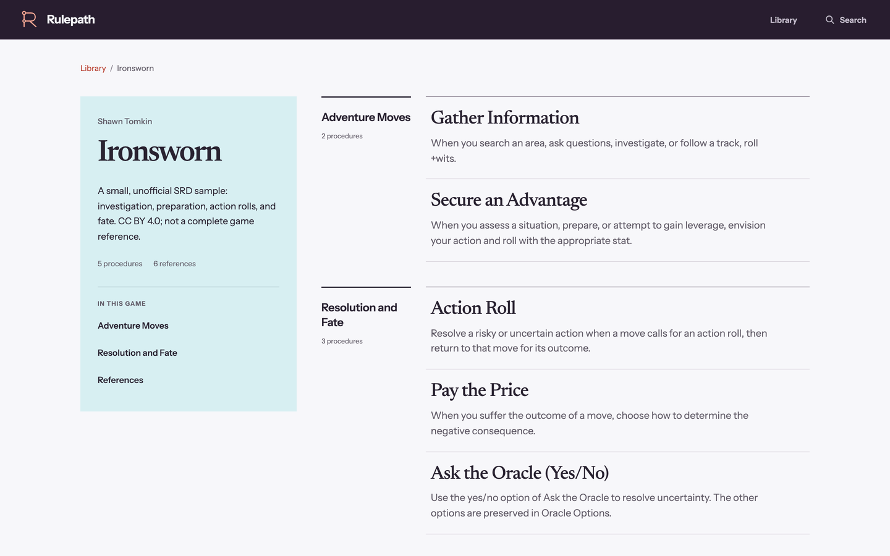
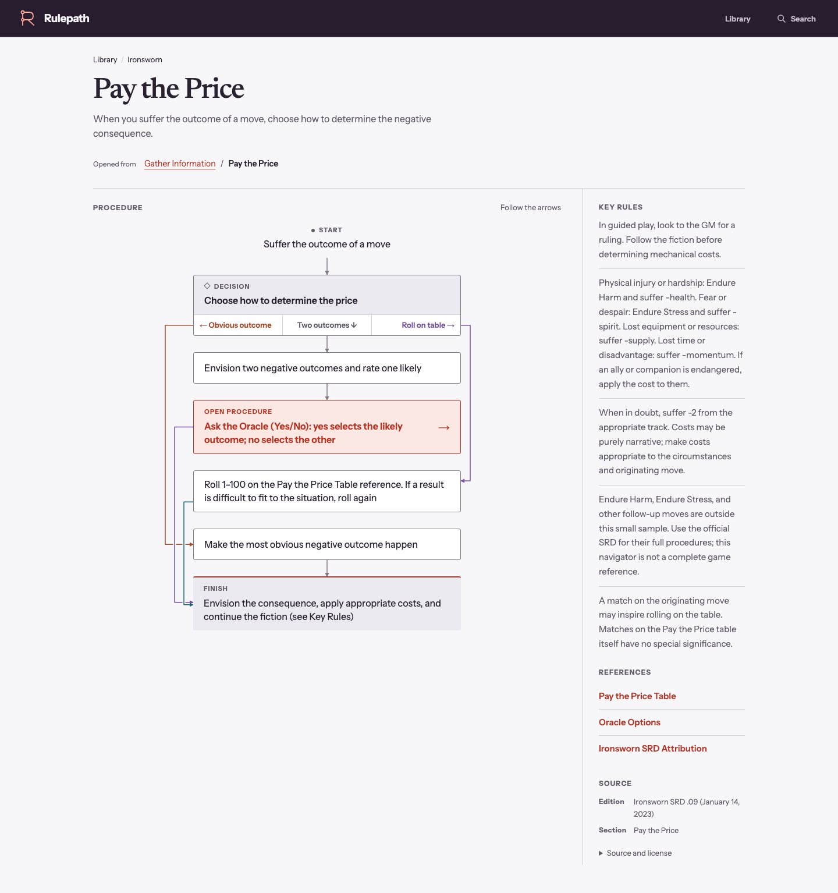

# Rulepath

Rulepath is a rules reference for board games and tabletop RPGs. Browse procedures as flowcharts, follow links between them, and open reference sheets without losing your place. Search across the library or within a game. The app works offline after an initial online load.

The bundled games are Ironsworn and Cairn Second Edition. Rulepath focuses on procedures: recognize a trigger, follow the decisions, and resolve the consequences. Supporting references provide the mechanical lookups needed along the way. Spell lists, asset cards, equipment catalogs, and setting material stay in the official game resources.

[Run locally](#development)

## Screenshots





## Implementation

Built with React, TypeScript, React Router, Vite, and CSS Modules.

- The [flow renderer](src/features/procedure/SemanticProcedureRenderer/SemanticProcedureRenderer.tsx) uses semantic HTML and SVG connectors to display branches, detours, and loops. Procedures are read-only; the app does not roll dice, choose outcomes, or track game state.
- [Navigation state](src/navigation/invocationPath.ts) preserves the path between procedures. References have direct URLs and open as contextual sheets with keyboard focus handling.
- Rules are authored in YAML and checked with Zod and graph validation for missing links, unreachable steps, and paths to an ending. Rules and fonts are bundled with the app and cached for offline use.

Vitest and Playwright cover content validation, navigation, rendering, responsive layouts, keyboard interaction, accessibility checks, and offline routes. [CI](.github/workflows/ci.yml) runs the checks and production build.

## Development

On Linux or macOS, use Node.js 22.20 or later in the Node 22 series, or a newer LTS, and npm:

```sh
npm ci
npm run dev
```

Open the local URL printed by Vite (usually `http://localhost:5173`). No API keys or backend setup are required for local use.

For browser tests, install Chromium. On Linux, install its system dependencies if needed:

```sh
npx playwright install chromium
# Linux only, if required:
npx playwright install-deps chromium
```

Run the checks and build:

```sh
npm run validate:content
npm run typecheck
npm test
npm run build
npm run test:e2e
```

`npm run validate:content` checks the included rules data. `npm run preview` serves the production build locally.

To capture the interface with Playwright:

```sh
npm run screenshots       # Eight desktop/tablet captures, including a build
npm run screenshots:full  # Phone, tablet, desktop, and interaction states
```

Captures go to `artifacts/screenshots/quick/` or `artifacts/screenshots/full/`. The [README screenshot notes](docs/screenshots/README.md) identify the selected views and image processing.

## Rules content

Rules content lives under `content/<game-id>/`. `game.yaml` defines the game's metadata and contents list; `procedures/` contains flow graphs; `reference/` contains supporting rules and lookup tables; and `crosslinks.yaml` records links between procedures. The content schema is in `src/content/schema.ts`.

References may contain optional `sections`, each with a `heading`, `paragraphs`, `bullets`, and an optional `table` with `columns` and `rows`. Table rows must match the column count. This structured content appears in both reference pages and contextual sheets, is indexed for search, and is bundled for offline use. Existing summary-only references remain supported.

Source and licensing metadata are defined in `game.yaml` and can be specified for individual resources. The app displays source information with each procedure and reference.

## Licensing and attribution

- Rulepath code and original assets: [MIT](LICENSE).
- Ironsworn procedures and supporting rules: adapted from Shawn Tomkin's SRD .09 and original move text under [CC BY 4.0](https://creativecommons.org/licenses/by/4.0/). See [source and full attribution](content/ironsworn/game.yaml) and the [content notice](content/ironsworn/LICENSE.md). Rulebook-only CC BY-NC-SA material is excluded.
- Cairn Second Edition procedures and supporting rules: adapted from Yochai Gal and contributors' Player's Guide and Warden's Guide under [CC BY-SA 4.0](https://creativecommons.org/licenses/by-sa/4.0/). See [source and full attribution](content/cairn-2e/game.yaml) and the [content notice](content/cairn-2e/LICENSE.md). ShareAlike applies to adapted Cairn content, separately from the application code.
- Fonts and other third-party assets: see [third-party licenses](docs/THIRD_PARTY_ASSETS.md).

Both game implementations are unofficial and imply no publisher endorsement. No publisher artwork, maps, icons, layouts or website code are included. The application's MIT licence is unchanged.
